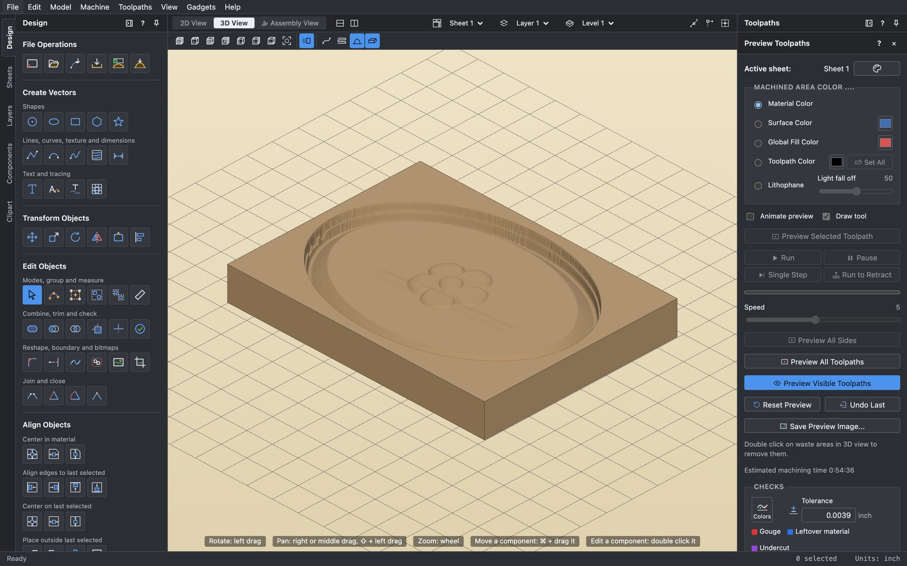
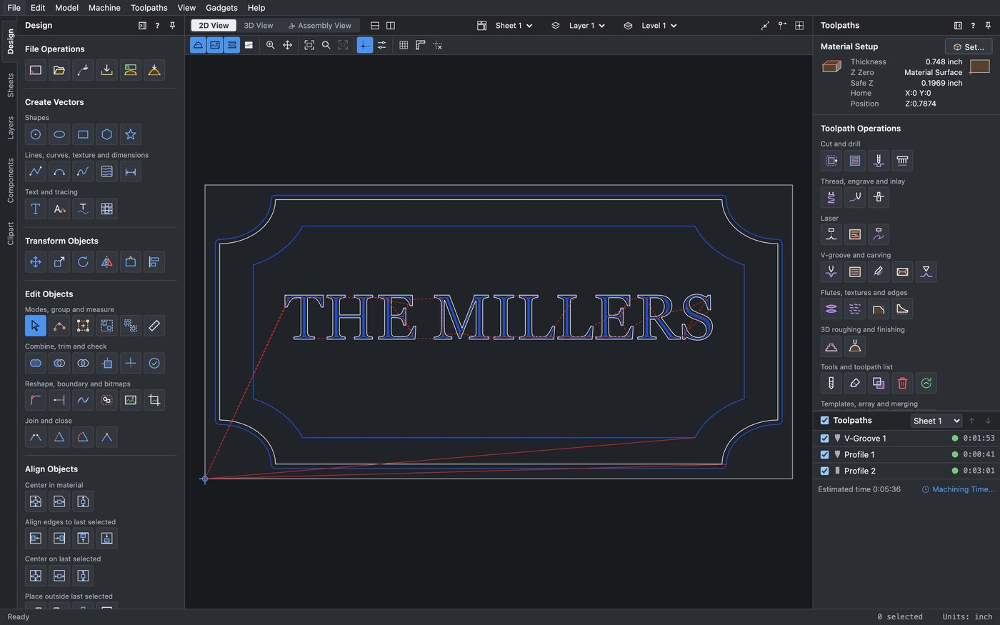
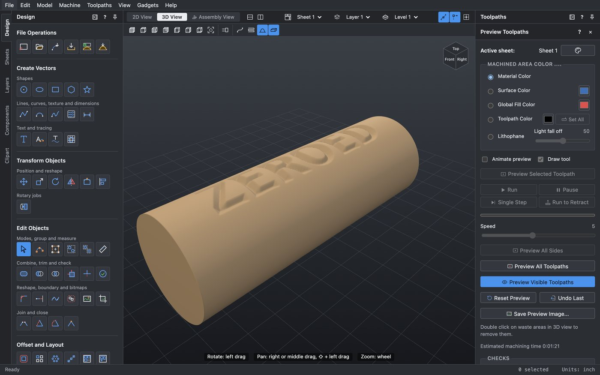
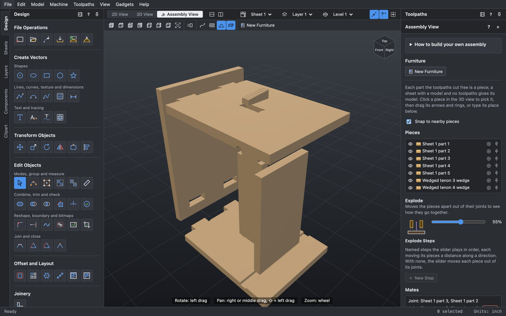
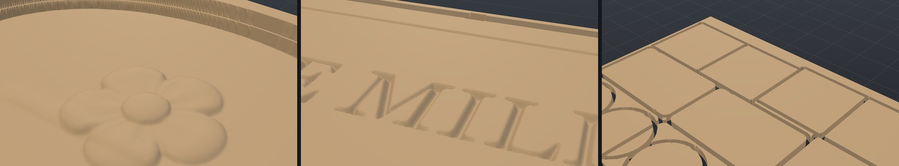

<div align="center">

# Zeroed

**From idea to cut.**

Free, open source CAD/CAM for CNC routers on macOS: draw it, model it,
calculate the toolpaths, watch it cut, then build it.

[](LICENSE)




</div>

## What it does

Zeroed takes a job from a blank sheet to G-code your machine can run, in one
app, with no subscription and no cloud account.

<table>
<tr>
<td width="50%"></td>
<td width="50%"></td>
</tr>
<tr>
<td><b>Design and toolpaths.</b> Vectors, text, offsets, booleans and arrays, with every toolpath drawn on the job.</td>
<td><b>Rotary 4th axis.</b> Design flat, preview it wrapped round the blank, and save A axis moves in inverse time.</td>
</tr>
<tr>
<td colspan="2"></td>
</tr>
<tr>
<td colspan="2"><b>See it go together before you cut.</b> The Assembly View puts your machined parts together, checks how the joints fit, and explodes them apart.</td>
</tr>
</table>



### Draw

Shapes, curves, text on a curve and in blocks, dimensions, node editing,
booleans, offsets, fillets, arrays and nesting. Imports SVG, DXF, DWG, EPS and
PDF. On-screen dimensions work in inches or millimeters.

### Model

Reliefs from Create Shape, Two-Rail Sweep, Turn and Spin, and Extrude and Weave,
plus sculpting brushes, levels and component editing. Imports STL, OBJ and 3DM
models, and exports STL and OBJ. A clipart library comes with about 1,000 items.

### Cut

Profile, pocket, drill, V-groove, engraving, chamfer, fluting, prism, texture,
inlay, molding, thread milling, 3D roughing and finishing, and laser cut, fill
and picture. Tabs, ramps, leads, tool database, toolpath templates and tiling.

### Check

A shaded material-removal preview, with the tool animated if you want it, that
flags rapids through material, gouges, leftovers, and holder and shank
collisions. Machining time estimates can use your machine's real accelerations.

### Build

A parametric Furniture Designer with 33 templates, a Joint Creator for slots,
tabs, dowels and cam locks, an Assembly View with mates, fit checks, sections
and explode steps, and cut lists with estimates.

## Runs on your machine

30 post processors ship with the app, and you can install or edit your own:

| Controller | Notes |
| --- | --- |
| LinuxCNC and UCCNC | Probing M6 or manual touch off, plus rotary A axis versions |
| GRBL and Mach3 / Mach4 | mm and inch, plus rotary versions |
| Snapmaker 2.0 | 200W CNC, 50W CNC and laser |
| ShopBot, Centroid, Fanuc, Heidenhain | Including conversational Heidenhain |
| Generic G code, drill banks, GRBL laser | A starting point for your own |

Every shipped post goes through an independent G-code checker in the test
suite, which replays each program and compares what it would cut with the
preview. It checks that Z lifts before any XY move at the file start and after
each tool change.

**Rotary axis.** Machine Configuration holds how your axis is wired: letter,
degrees or linear units, and direction. If a scrap cut reads mirrored, flip
Direction and save again. Rotary jobs clear with a raster along the blank, with the
rotary axis turning between passes.

> [!WARNING]
> CNC machines can hurt you and wreck your work. Always run an air cut first.
> Work through the [machine checklist](docs/testing/cut-checklist.md) once per
> machine and post. Rotary and Snapmaker output is tested in software and has not
> yet been run on those machines.

## Get started

Zeroed has no prebuilt download yet, so build it from source on an Apple Silicon
Mac. You need [Rust](https://rustup.rs), Node 22 or newer, pnpm 10 or newer, and
the Xcode command line tools.

```bash
git clone https://github.com/redacted-member/zeroed.git
cd zeroed
pnpm -C app install
pnpm -C app tauri build --bundles app dmg
```

The app lands in `target/release/bundle/macos/`. To work on it in a browser
against the real kernel, run `pnpm -C app dev`.

Jobs save as `.carve` files.

More in [docs/DEVELOPMENT.md](docs/DEVELOPMENT.md) and
[docs/KERNEL_API.md](docs/KERNEL_API.md).

## How it's built

```
crates/carve-core/   the kernel in Rust: geometry, modeling, CAM, posts, file formats
app/                 the interface in React and TypeScript, 3D in three.js
app/src-tauri/       the macOS shell, in Tauri
tools/gcode-check/   the independent G-code checker
docs/testing/        whole project workflows the test suite replays
```

More than 4,000 tests run on every change, across the kernel and the interface.

## Contributing

Fixes and features are welcome. See [CONTRIBUTING.md](CONTRIBUTING.md).

## License

Zeroed is free software under the
[GNU Affero General Public License, version 3 or later](LICENSE). You can use it
for anything, including paid work, and what you cut with it is yours.

If you share a modified version, or let people use one over a network, you must
publish your source under the same license. We ask that you also send your fixes
back here so everyone gets them.

Bundled clipart, furniture templates and fonts keep their own licenses: see
[the clipart notes](crates/carve-core/assets/clipart/README.md),
[the furniture notes](docs/licenses/furniture-library.md) and
[the font license](crates/carve-core/assets/fonts/OFL.txt).

Copyright (C) 2026 David French. Comes with no warranty.
